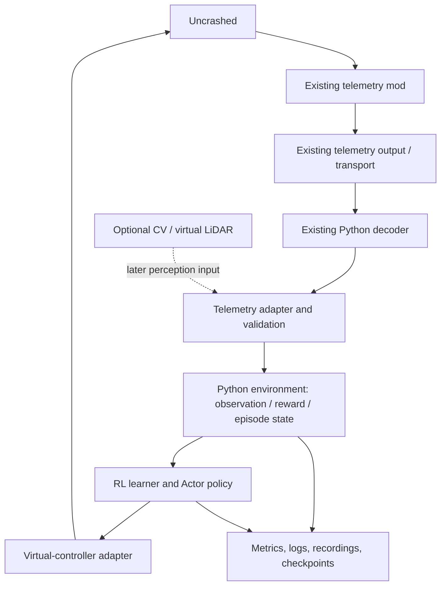

# Virtual-AI-Drone
## Uncrashed Simulator-Only RL Architecture and Implementation Plan
 
**Primary objective:** Train an AI pilot that controls the drone autonomously inside Uncrashed, first learning reliable flight and then progressing toward waypoint navigation and obstacle-course flight.  
**Current deployment scope:** Simulator only. Physical-drone deployment and sim-to-real transfer are not implementation requirements for this version.

> **Architecture update:** The telemetry mod and Python decoder already exist. This document treats them as completed project components and builds the training/control system around them. It does not propose rebuilding telemetry extraction from scratch.
---

## 1. Executive summary

The recommended initial approach is:

- **Telemetry:** Keep the existing mod and Python decoder.
- **Control:** Implement a virtual-controller adapter and calibrate the game's four primary control axes.
- **Environment:** Build a Gymnasium-style Python environment around the current telemetry and controller.
- **First learning task:** Start with a simple, measurable flight task. Use waypoint navigation only when the target's position can be defined in the same coordinate system as the telemetry.
- **RL:** Start with a compact state-based continuous-control policy and a CrossQ implementation. Keep DroQ as a later comparison, not a simultaneous first implementation.
- **Obstacle perception:** Treat computer vision / virtual LiDAR as a separate, optional perception workstream. The current README does not say that obstacle distances or raycasts are already available from the mod.
- **Decoder migration:** Keep the existing Python decoder while the environment is being developed. Move it to Rust only after profiling shows that decoding is a meaningful bottleneck and the telemetry contract is stable.

The main architectural risk has changed. The immediate problem is no longer how to obtain basic telemetry; it is how to validate and consume that telemetry, control the drone reliably, reset episodes, and define a reward signal that teaches useful flight rather than hovering or exploiting the score.

---

## 2 Scope for this version

**In scope**

- Fully autonomous control of the Uncrashed drone while the agent is active.
- Low-latency telemetry-to-action loop.
- Reuse and validation of the existing telemetry mod and decoder.
- Virtual-controller integration.
- Crash handling and automated episode reset, once a reliable reset method is identified.
- Reward design, RL training, evaluation, and model checkpointing.
- Optional obstacle perception as a later capability.
- Clear console/log output for telemetry, controller state, and training progress.

**Out of scope for the initial version**

- Physical FPV drone deployment.
- Guaranteeing sim-to-real transfer.
- Supporting arbitrary simulators or games.
- Training from raw RGB images as the first baseline.
- Building the public desktop application before the AI can fly reliably.

The README mentions real-world scaling as a concern and a non-functional requirement. Keep that concern documented as future research, but do not let it block the simulator-only implementation. Game physics and telemetry may not correspond accurately to a real drone, so a successful Uncrashed policy must not be presented as flight-ready hardware software.

---

## 3. Existing telemetry mod: actual output contract

This section is based on the supplied Lua mod. It supersedes the earlier README-only list of speed, position, orientation, and crash status.

### 3.1 Sampling and output mechanism

| Detail | What the supplied mod does | Implementation implication |
|---|---|---|
| Sampling loop | Schedules `detectionLoop()` with `ExecuteWithDelay(25)` | Nominal target is approximately 25 ms / 40 Hz, not a guaranteed fixed-rate physics stream |
| Output path | `%TEMP%\TelemetryCrX\state.json` (or `.` if `TEMP` is unavailable) | Existing decoder should read this exact configured location or share the same configuration |
| Output format | One JSON object representing the latest sample | This is a latest-state snapshot/mailbox, not an append-only JSONL log |
| Write behavior | Opens the file with mode `w`, writes, flushes, and closes it | A reader can race the writer and see a temporarily incomplete JSON file; decoder should retry parse failures or the writer can later be made atomic |
| Sequence | `seq` increments before the file-write attempt | Use it to distinguish new snapshots; a gap can mean an unread sample, a skipped teleport-guard tick, or a failed file write |
| Source time | `t` is populated from Lua `os.clock()` | Verify its semantics in the UE4SS runtime; do not assume it is wall-clock time or use it alone for host-side sample-age measurement |
| Availability | If Lua `io.open` is unavailable, the mod switches to console-only mode | Python must detect a missing/stale file and report the telemetry transport as unavailable |
| Teleport guard | A large position jump clears derived history and skips that telemetry write | Expect an occasional sequence gap around resets/teleports; do not interpret it as ordinary motion |

The 25 ms delay is a scheduling target. Actual sample timing can vary with the game, UE4SS scheduling, and system load. Measure the arrival interval using a Python monotonic clock and the `seq` value. A sequence gap is diagnostic, but it does not by itself prove a lost game/physics sample: the code increments `seq` before attempting the write and also skips writes in the teleport guard. Separately verify the Lua-side `os.clock()` semantics because it is used for more than telemetry labeling.

### 3.2 JSON fields currently written

The mod's `writeTelemetry()` function currently emits the following fields:

| JSON field | Source / meaning | Recommended use |
|---|---|---|
| `seq` | Local telemetry write sequence | Freshness, duplicate detection, and gap diagnostics |
| `t` | `os.clock()` at sample time | Diagnostic source timestamp only, pending validation of runtime semantics |
| `speed` | Magnitude of `drone:GetVelocity()` | Diagnostics; optional redundant Actor feature |
| `x`, `y`, `z` | `K2_GetActorLocation()` | Position state, relative-position calculation, and task progress if target coordinates share the same frame |
| `vx`, `vy`, `vz` | `drone:GetVelocity()` | Direct linear-velocity state; do not estimate velocity from position unless needed as a fallback |
| `pitch`, `yaw`, `roll` | `K2_GetActorRotation()` | Attitude/orientation state; confirm conventions and encode periodic angles carefully |
| `gyro_x`, `gyro_y`, `gyro_z` | Selected angular-rate source | Angular-rate state; interpretation depends on `gyro_src` and must be calibrated |
| `gyro_src` | `derived`, `physics`, or initially `none` | Validity/source metadata for the angular-rate fields |
| `crashes`, `resets` | Cumulative event counters | Detect events even if the decoder misses a one-tick event flag |
| `crash_ev`, `reset_ev` | Per-write boolean event flags | Immediate episode event indication; do not rely on these alone if polling can miss snapshots |
| `armed` | Blueprint `Armed?` property | Game-state validation and episode-start gating; optional Actor feature |
| `is_3d` | Blueprint `IS3D?` property | Flight-mode metadata; keep the mode fixed initially or expose it explicitly to the policy |
| `throttle` | Blueprint `ThrottleAxis` property | Controller-input readback and calibration diagnostics |
| `pitch_in` | Blueprint `PitchAxis` property | Controller-input readback and calibration diagnostics |
| `roll_in` | Blueprint `RollAxis` property | Controller-input readback and calibration diagnostics |
| `yaw_in` | Blueprint `YawAxis` property | Controller-input readback and calibration diagnostics |

Representative shape (values are illustrative, not a recorded sample):

```json
{
  "seq": 1234,
  "t": 18.42,
  "speed": 820.0,
  "x": 120.0, "y": -45.0, "z": 260.0,
  "vx": 700.0, "vy": 120.0, "vz": -390.0,
  "pitch": -12.0, "yaw": 35.0, "roll": 8.0,
  "gyro_x": 15.0, "gyro_y": -22.0, "gyro_z": 40.0,
  "gyro_src": "derived",
  "crashes": 2, "resets": 5,
  "crash_ev": false, "reset_ev": false,
  "armed": true, "is_3d": true,
  "throttle": 0.52, "pitch_in": -0.10,
  "roll_in": 0.04, "yaw_in": 0.00
}
```

### 3.3 Velocity and coordinate semantics

The mod already provides `vx`, `vy`, and `vz` from `drone:GetVelocity()`. This is a significant improvement over the README summary and is preferable to deriving velocity from consecutive positions.

The mod also reads position from `K2_GetActorLocation()` and orientation from `K2_GetActorRotation()`. Unreal commonly uses centimetre-based world units and degree-based rotators, but the project's exact game coordinate scaling, axis direction, and conversion behavior must still be confirmed in a controlled test. Do not bake assumed units or signs into the reward or controller mapping before validation.

`speed` is calculated as the Euclidean magnitude of the velocity vector. It is therefore useful for logging and can be omitted from the Actor observation initially because it is mathematically redundant with `(vx, vy, vz)`.

### 3.4 Gyroscope source and caveats

The mod currently defaults to:

```lua
local GYRO_MODE = "derived"
```

**High-priority timing check:** the code uses `os.clock()` as `now` and `dt` inside `detectionLoop()`. That same clock drives derived angular rates, fallback deceleration, the crash cooldown, and the JSON `t` value. In standard Lua, `os.clock()` is CPU time rather than guaranteed elapsed wall/game time. Verify whether UE4SS overrides that behavior. If it is CPU time in this runtime, the derived gyro rates, deceleration threshold, and cooldown timing will not represent real elapsed time correctly. Replace it with a verified monotonic elapsed-time or game-time source before relying on those calculations.

- **`derived`:** Calculates roll, pitch, and yaw rates from the change in Euler angles divided by elapsed sample time. It wraps angular differences across ±180 degrees. In this mode, the code maps `gyro_x` to roll rate, `gyro_y` to pitch rate, and `gyro_z` to yaw rate.
- **`physics`:** Reads `GetPhysicsAngularVelocityInDegrees()` from the drone's SkeletalMeshComponent accessed through `drone.drone`. It is not necessarily the Actor's RootComponent. The component-vector axis/sign correspondence with roll/pitch/yaw must be experimentally verified before using this mode for training. If physics data is unavailable for a sample, the current code falls back to derived Euler rates once those are available; therefore `gyro_src` is the authoritative per-sample source indicator.
- **`none`:** Can occur before enough derived samples exist or when no usable source has been selected. The JSON numeric fields may then be zero, so the decoder must use `gyro_src` to distinguish a valid zero rate from unavailable gyro data.

The status loop prints both the selected rates and the raw physics-rate comparison to the console, but the JSON currently contains only the selected `gyro_x/y/z` values plus `gyro_src`. The raw comparison values `physX/physY/physZ` are not currently separate JSON fields.

Before training, record the drone in controlled roll/pitch/yaw movements and compare both gyro modes. Select one mode, document its axis/sign mapping, and keep it consistent across all training runs. If desired, extend the JSON later to include both sources separately rather than overloading the selected fields.

### 3.5 Crash and reset event semantics

The mod does **not** publish a persistent boolean named `crash_status`. It publishes event flags and cumulative counters:

- `crash_ev`: true for the telemetry write on which `registerCrash()` accepts a crash event; normally false on later writes.
- `crashes`: cumulative accepted crash count for the current mod session.
- `reset_ev`: true for the telemetry write on which one of the hooked reset functions is observed.
- `resets`: cumulative observed reset count for the current mod session.

The collision hook listens to the drone mesh hit event. It calculates the `NormalImpulse` magnitude and sets `crashFlag` when the magnitude is greater than `HIT_IMPULSE_MIN`. `registerCrash()` applies `CRASH_COOLDOWN` so multiple collision callbacks from one impact are not counted repeatedly.

Current defaults in the supplied mod:

| Setting | Default | Meaning |
|---|---:|---|
| `HIT_IMPULSE_MIN` | `0` | Any positive impulse can qualify as a hit; tune after inspecting logged hit magnitudes |
| `CRASH_COOLDOWN` | `0.5 s` | Suppresses duplicate crash registrations during the cooldown |
| `JUMP_MIN` | `300` game units | Extra tolerance in the position-jump/teleport guard |
| `FALLBACK_DECEL` | `14000` units/s² | Speed-drop fallback threshold, used only before the hook has ever fired |
| `FALLBACK_MIN_SPEED` | `300` units/s | Minimum prior speed for fallback crash detection |
| `FALLBACK_ANG_SPIKE_3D` | `300 deg/s` | Additional 3D-mode fallback confirmation threshold |

**Important implementation detail to verify:** `hookEverFired` becomes true whenever the hit callback fires, even if the impulse is below `HIT_IMPULSE_MIN`. Since the fallback detector runs only while `hookEverFired` is false, one low-impulse hit callback disables fallback detection for the rest of that mod session. Decide whether this is intended; if not, change the fallback gating separately and test it.

The reset hooks observe the game's `Reset Quad` and `full reset` functions. They notify the environment that an in-game reset occurred; they do not themselves expose a Python-callable reset command. A separate controller/UI reset mechanism is still required for automated episode resets.

The teleport guard clears derivative history after a large position jump and returns before writing that tick's JSON. Treat this as a possible sample gap, not automatically as a confirmed reset event. Prefer the explicit reset counter/event to recognize reset boundaries.

### 3.6 Stick-axis readback is not controller actuation

The values `throttle`, `pitch_in`, `roll_in`, and `yaw_in` are read from the game's Blueprint axis properties. They are useful for checking what input the game currently sees and for calibrating the virtual controller.

The supplied mod does **not** show code that sends controller commands or sets those axis properties. Virtual-controller actuation remains a separate component and must be implemented/tested independently.

### 3.7 Features not currently provided by this mod

Do not assume the current JSON includes:

- Obstacle distances, native raycasts, virtual LiDAR, or depth images.
- Gate/waypoint locations or map geometry.
- Acceleration or a full rigid-body state beyond the fields listed above.
- A programmatic command to reset the drone.
- Raw physics angular velocity separately from the selected JSON gyro values.
- A guaranteed game-frame timestamp or fixed physics-step identifier.

The current telemetry is sufficient for a state-based flight/control baseline. It is not sufficient by itself for obstacle avoidance in an unknown environment. That task needs known target/map information or a new obstacle-perception source.

### 3.8 Telemetry contract validation

Before training, verify and document:

1. Units and scale for position, velocity, and speed.
2. World axis orientation and positive directions for X/Y/Z.
3. Euler rotation order, signs, and degree convention.
4. Gyro mode, axis/sign mapping, and behavior during fast rotations.
5. Actual sample interval distribution and whether `seq` is strictly increasing during normal operation.
6. Meaning and runtime behavior of `os.clock()` in the UE4SS Lua environment; this affects derived gyro rates, fallback deceleration, crash cooldown, and the JSON `t` field.
7. JSON file read/write race behavior and recovery from partial reads.
8. Whether crash/reset event flags can be missed by the decoder and how counters recover those events.
9. False-positive/false-negative behavior of crash detection across floor scrapes, wall impacts, and hard braking.
10. Whether reset hooks fire for every reset path the training environment will use.

Save representative recordings for normal flight, axis movements, impact, reset, disarm, and teleport/spawn transitions. Use them as regression fixtures for the Python decoder and any future Rust migration.

## 4. Updated high-level architecture

The system should build around the already completed telemetry pipeline.



The diagram describes the intended logical data flow. It does not prescribe the implementation details of the existing mod's transport, because those details are not specified in the README and should be preserved from the current code.

### 4.1 Component responsibilities

| Component | Status | Responsibility |
|---|---|---|
| Uncrashed | Existing | Runs the game physics, drone, maps, and in-game flight controller |
| Telemetry capture mod | **Already implemented** | Extracts the currently supported telemetry fields |
| Telemetry transport/output | Existing; inspect implementation | Carries mod output to the decoder |
| Python decoder | **Already implemented** | Converts the existing output into usable values |
| Telemetry adapter | To implement | Validates values, handles stale data, applies coordinate/angle conversions, creates observations |
| Environment manager | To implement | Owns `reset`, `step`, episode state, task/target, rewards, and termination |
| RL learner | To implement | Trains the policy from collected transitions |
| Actor policy | To implement | Converts observations into control actions |
| Virtual-controller adapter | To implement | Maps policy actions to the input mechanism accepted by Uncrashed |
| Reset adapter | To investigate/implement | Resets the drone or game and confirms a clean new episode |
| Logger/evaluator | To implement | Saves metrics, flight traces, failures, checkpoints, and latency measurements |
| CV / virtual LiDAR | Optional later component | Estimates obstacle geometry from rendered game information if needed |

### 4.2 Keep the existing telemetry mod independent

The training code should consume decoded telemetry through a stable Python interface. It should not need to know how the mod internally finds game objects or extracts values.

Recommended separation:

- The mod is responsible for extracting and publishing game data.
- The decoder is responsible for parsing the existing output format.
- The telemetry adapter is responsible for converting decoded fields into a validated internal state object.
- The environment is responsible for task logic and RL semantics.
- The controller adapter is responsible for sending actions to the game.

This separation keeps the existing mod reusable and makes later changes to the decoder or controller less disruptive.

---

## 5. Telemetry ingestion and state model

### 5.1 Internal state object

Map the exact JSON contract into one canonical Python object. The raw JSON field names should remain at the decoder boundary; other modules should consume this typed representation.

Conceptual structure:

```python
@dataclass(frozen=True)
class DroneTelemetry:
    seq: int
    source_time: float | None
    received_at: float                 # time.monotonic() when Python read the sample
    speed: float
    x: float
    y: float
    z: float
    vx: float
    vy: float
    vz: float
    pitch_deg: float
    yaw_deg: float
    roll_deg: float
    gyro_x: float
    gyro_y: float
    gyro_z: float
    gyro_source: str                   # "derived", "physics", or "none"
    crash_count: int
    reset_count: int
    crash_event: bool
    reset_event: bool
    armed: bool
    is_3d: bool
    throttle_input: float
    pitch_input: float
    roll_input: float
    yaw_input: float
```

The exact class can be split into nested `Vector3`, `EulerAngles`, and `StickInputs` types if that makes the code cleaner. Preserve `seq`, `received_at`, and the cumulative counters; they are important to the environment, not just diagnostics.

`source_time` should be optional until `os.clock()` semantics are verified. `received_at` must be generated by Python using a monotonic clock and is the initial reliable basis for sample-age and host-side timing measurements. `gyro_source == "none"` means the numeric gyro fields must not be interpreted as valid measurements.

The JSON currently contains a `seq` and cumulative crash/reset counters. These counters and the sequence are in-memory session values and will restart if the mod is reloaded; treat a rollback as a telemetry-session restart, not as a negative event count. Do not invent a separate source sequence number or collapse event flags into a persistent `crashed` boolean.

### 5.2 Validation rules

Reject or flag a sample if:

- Required JSON keys are missing or have incorrect types.
- A numeric value is NaN or infinite.
- The JSON file is temporarily incomplete because the decoder read while the mod was rewriting it; retry briefly, then mark the sample unavailable rather than passing partial data to the policy.
- `seq` has not changed since the last processed snapshot; this is a repeated/stale read, not a new environment step.
- The receive age exceeds the configured timeout.
- `seq` jumps unexpectedly; record the gap. A gap can occur if Python polls slower than the nominal telemetry rate, around the mod's teleport guard, or when the file write fails after the sequence has already incremented.
- Position/velocity/orientation changes are implausible and are not explained by an explicit reset event/counter change.
- `gyro_source == "none"` when the selected observation schema requires valid angular rates.
- Boolean/event fields cannot be interpreted reliably.

Do not silently replace invalid values with zero. Zero may be a valid position, angle, speed, velocity, or input value.

Because the mod overwrites one JSON file rather than appending every sample, the decoder should poll/read the latest snapshot, parse it, and process only when `seq` changes. If the reader misses a brief `crash_ev` or `reset_ev` pulse, compare `crashes` and `resets` with their previous values; a counter increment still reveals that an event occurred. For training data, log every successfully processed sample in a separate append-only recording format.

### 5.3 Timing and latency

The README explicitly identifies latency as a project constraint. Measure the complete loop rather than just the Python decoder's execution time.

Track at least:

- Time between received telemetry samples.
- Decoder/adapter processing duration.
- Policy inference duration.
- Controller command submission duration.
- Time from command submission to a visible change in telemetry, where it can be estimated.
- End-to-end observation-to-next-observation delay.
- Stale, duplicate, or missing sample count.

Use monotonic clocks for local durations. If the mod does not expose a game-frame timestamp, the first measurements will be approximate because receiver time is not the same as the exact physics-sample time. Document that limitation.

A fast model does not guarantee a fast control loop: the virtual controller and Uncrashed's input polling/frame update can dominate the actual response time.

### 5.4 Console output

The supplied mod already prints a status summary approximately once per second, including speed, position, selected gyro rates/source, orientation, crash/reset counters, hit-hook status, raw physics gyro comparison, `IS3D?`, `Armed?`, and current stick-axis values. Keep that mod-level output for debugging, but let the Python application own training diagnostics.

Suggested Python logging modes:

- **Debug:** New `seq`, all decoded fields, raw JSON parse errors, sample interval, and controller input readback.
- **Normal:** Speed, velocity, position, orientation, gyro source, armed/3D state, crash/reset counters, telemetry age, and controller state.
- **Training:** Episode, step, reward components, cumulative reward, crash/success, policy inference time, action-to-telemetry delay, and control rate.

Use structured append-only log files for full-rate telemetry rather than relying on console output or the mod's latest-state JSON file as a historical training dataset.

---

## 6. Observation design

### 6.1 Use the fields the mod actually provides

The current mod provides a substantially richer numeric state than the original README checklist: position, full linear velocity, orientation, selected angular rates, flight-mode/armed flags, and stick-input readback. A compact state-based MLP is the appropriate first policy class.

Do not use the old 91-feature proposal. The mod does not currently provide 64–128 obstacle rays, target/gate coordinates, or map geometry.

### 6.2 Recommended telemetry-based Actor observation

For the first controlled-flight task, a candidate observation schema is:

| Feature | Dimensions | Source / notes |
|---|---:|---|
| Position, preferably relative to episode start or task reference | 3 | `x`, `y`, `z`; exact coordinate convention still needs calibration |
| Linear velocity | 3 | `vx`, `vy`, `vz`; direct from `GetVelocity()` |
| Orientation encoded as sine/cosine | 6 | `pitch`, `yaw`, `roll`; convert degrees and encode periodic values |
| Angular rates | 3 | `gyro_x`, `gyro_y`, `gyro_z`; only when `gyro_src` is valid and mapping is confirmed |
| Previous executed action | 4 | Tracked by the environment; normalized throttle/roll/pitch/yaw command from the preceding control step |
| Armed / mode flags | 1–2 | `armed` and optionally `is_3d`; keep flight mode fixed for the first baseline if possible |
| **Candidate subtotal** | **20–21** | Depending on whether both flags are included |

This is a candidate, not a frozen contract. Remove absolute world position if it encourages memorizing one spawn/map origin; use position relative to a target or episode reference when that makes sense for the task. Add target-relative direction/distance only after the environment has a reliable target coordinate in the same world frame.

`speed` is the magnitude of `(vx, vy, vz)`, so keep it in logs and optionally include it in ablation experiments, but it is redundant in the initial Actor input. `throttle`, `pitch_in`, `roll_in`, and `yaw_in` are game input readbacks; initially use them to validate controller behavior rather than duplicating the environment's own previous-action history.

`seq`, `t`, `crashes`, `resets`, `crash_ev`, and `reset_ev` belong to telemetry/episode management and generally should not be Actor features. `crash_ev` and `reset_ev` are event indicators, not ordinary continuous state.

### 6.3 What the current observation can teach

With exact velocity, pose, angular rates, and control history, the Actor can learn state-based flight stabilization and controlled movement. It can also learn to move toward a known waypoint if the environment supplies target-relative information.

The current telemetry does not say where obstacles or gates are. Therefore it cannot, by itself, support reliable avoidance of previously unknown obstacles. For obstacle-course navigation, either provide known course/gate coordinates or add an obstacle sensor representation in the separate perception workstream.

### 6.4 Crash and reset data belongs primarily to environment logic

Use `crash_event` and changes in `crash_count` to identify a crash. Use `reset_event` and changes in `reset_count` to identify reset boundaries. These values should drive termination, reward, and episode bookkeeping; they normally do not need to be Actor inputs.

Do not treat `crash_event` as a persistent crashed-state flag. It is emitted for the telemetry write on which a crash is registered. If Python can miss that snapshot, the cumulative `crash_count` is the recovery mechanism.

### 6.5 Angle representation and normalization

The mod reads Euler angles from `K2_GetActorRotation()` and uses 180-degree wrapping in its derived-rate calculation. Confirm the angle conventions and signs before training. Recommended handling:

- Convert degrees to radians in the observation adapter if that is the policy's chosen convention.
- Encode periodic angles using sine and cosine to avoid discontinuities around ±180 degrees.
- Normalize position, velocity, and angular rates using ranges measured from recorded flights.
- Keep normalization parameters in a versioned configuration file and save them with every checkpoint.

Do not select numeric scales until representative telemetry has been recorded. Clipping ranges that are too narrow can hide important flight states; ranges that are too wide can make learning difficult.

### 6.6 Timing, gyro validity, and action history

The mod's nominal cadence is approximately 40 Hz, but the actual interval must be measured. Use the Python receive timestamp and sequence number to detect stale/repeated samples and variable intervals.

Use the selected `gyro_x/y/z` only when `gyro_src` is `derived` or `physics`, and only after the chosen source's axes/signs have been calibrated. The default is `derived`; switching to `physics` changes the meaning/source of those fields and must be recorded in the experiment configuration.

Concatenate the previous one or more actions if delayed control makes action history useful. The environment should track the action it actually submitted, while the telemetry stick-axis fields can be used to verify what the game read.

## 7. Obstacle perception: telemetry-only versus virtual LiDAR

The README identifies an important concern: **running the AI using telemetry alone may constrain it to mostly hovering**, and it lists computer vision on a virtual LiDAR representation as a possible solution.

This is a real architectural distinction. Position, speed, and orientation tell the agent how the drone is moving, but they do not tell it where nearby obstacles are. A policy cannot reliably learn collision avoidance from obstacle information that is not present in its observation or inferable from a known map/task.

### 7.1 Stage 1: telemetry-only flight

Use the existing telemetry to prove that the AI can:

- Receive state reliably.
- Control the four primary axes.
- Learn basic stabilization or controlled movement.
- Follow a target only if its location is known to the environment.
- Detect and learn from crashes.

This stage validates the control and RL pipeline. It should not be presented as a completed obstacle-avoidance system.

### 7.2 Stage 2: add obstacle information

Before training a racing/obstacle-avoidance policy, add a sensor representation that tells the Actor where obstacles are.

The README suggests **computer vision on virtual LiDAR**. Keep this as an independent module with a defined output contract, for example:

```text
obstacle_observation:
    distances: [d_0, d_1, ..., d_n]
    valid: [true/false, ...]
```

This could represent distances or normalized proximity values along a fixed set of directions in the drone's field of view. The ray ordering, angle coverage, maximum range, and no-hit value must be documented and remain stable during training and evaluation.

Potential implementation paths to investigate:

1. **Native game raycasts:** Extend the existing mod only if it is technically feasible to query game geometry and expose ray distances. This would not be computer vision; it would be direct simulated sensing.
2. **Vision-derived virtual LiDAR:** Capture the rendered game view and estimate obstacle proximity/distance along virtual rays. This is closer to the README's computer-vision idea, but it introduces image-processing latency and depth-estimation uncertainty.

Do not assume either path is already implemented. Prototype and benchmark them before selecting one. Keep the perception interface separate from the Actor so a later implementation can replace the source without rewriting the environment.

### 7.3 When visual perception becomes a requirement

If the target task is navigating unknown or changing obstacle courses, obstacle perception is required unless the agent is given a known map or explicit gate/waypoint locations. For a known course with target coordinates, telemetry plus goal information may be enough to test goal-directed flight, but it does not automatically provide collision avoidance.

---

## 8. Control and virtual-controller integration

The README identifies virtual-controller support as unfinished work. This is the next major integration task after confirming the telemetry contract.

### 8.1 Controller abstraction

Do not let the RL algorithm call a specific virtual-controller library directly. Define an adapter with a small interface:

```python
class DroneController:
    def connect(self) -> None: ...
    def send_action(self, action: "ControlAction") -> None: ...
    def neutralize(self) -> None: ...
    def close(self) -> None: ...
```

A separate reset/input adapter may be needed for keyboard shortcuts or UI actions. Keep reset separate from normal flight control.

### 8.2 Action representation

For the first controller implementation, define a normalized four-axis command matching the game's actual control layout, for example:

```text
[throttle, roll, pitch, yaw]
```

Each channel should have a documented range and neutral/midpoint behavior. The game may apply Betaflight-style rate/expo/throttle settings after reading the virtual controller, so do not assume that a stick value is itself a physical angular rate.

The earlier research used CTBR terminology (collective thrust and body rates). Treat CTBR as a desired control abstraction only if the game input mapping and response have been calibrated to support that interpretation. When sending virtual gamepad axes, describe the actual interface as normalized stick channels unless direct body-rate control is confirmed.

### 8.3 Calibration procedure

Before RL training, manually test each axis with short, controlled commands:

1. Confirm which virtual axis controls throttle, roll, pitch, and yaw.
2. Determine positive and negative directions.
3. Determine whether throttle is centered or has a low-to-high range.
4. Test neutral input and the expected hover/mid-throttle behavior.
5. Confirm the game's input mode and rates/expo settings.
6. Measure how long it takes for a command to affect telemetry.
7. Confirm that disconnecting or stopping the agent leaves the game in a safe input state.

Record the mapping in `control.yaml` and add a repeatable calibration test.

### 8.4 Driver choice

The README does not identify a selected virtual-controller library. Choose one only after checking current Windows/game compatibility and testing it with Uncrashed. Keep the controller adapter replaceable so a driver change does not affect the RL code.

### 8.5 Control interval

Do not assume that sending inputs at a very high polling rate means Uncrashed consumes them at that rate. The game's render/physics/input polling cycle determines when actions are applied.

Start with an interval that can be synchronized to the observed telemetry/game update cadence. Measure action-to-telemetry response, dropped commands, and repeated commands before increasing the control rate.

---

## 9. Environment and episode lifecycle

The Python environment is the central integration point between telemetry, control, rewards, and the RL algorithm.

### 9.1 Gymnasium-style API

Implement the familiar interface:

```python
observation, info = env.reset(seed=seed)

next_observation, reward, terminated, truncated, info = env.step(action)
```

### 9.2 `reset()` responsibilities

1. Request an in-game reset through a separate keyboard/UI/controller reset adapter. The telemetry mod itself only observes reset functions.
2. Wait for the game/drone to return to a known state.
3. Confirm that `resets` increased or `reset_ev` was observed.
4. Verify that telemetry is fresh and plausible, the drone is in the expected armed state, and the crash count did not unexpectedly change.
5. Set or select the task target if the current task uses one.
6. Clear action and observation history.
7. Return the initial observation.

**Current status:** The supplied mod detects the game's `Reset Quad` and `full reset` functions and reports them through `reset_ev` / `resets`. It does not expose a command for Python to initiate those functions. Reset automation remains an implementation item.

A keyboard/UI reset workaround can be used for a prototype if necessary, but it must be tested for repeatability. Do not begin long training runs until resets can be performed reliably or a clearly defined manual-reset limitation is accepted for a short experiment.

### 9.3 `step(action)` responsibilities

1. Validate action shape and ensure all values are finite.
2. Clamp commands to the configured range.
3. Send the action through the controller adapter.
4. Wait for a fresh telemetry sample or a defined timeout.
5. Validate the telemetry sample.
6. Build the next observation.
7. Calculate each reward component.
8. Check crash, success, timeout, and integration-failure conditions.
9. Return the transition and diagnostics.

### 9.4 Terminal conditions

- `terminated=True`: a task terminal event occurred, such as a crash or successful objective completion.
- `truncated=True`: the episode ended because of a time/step limit or an external cutoff.
- Telemetry corruption, decoder failure, or controller/IPC timeout should be treated as an environment error or explicitly logged aborted episode, not silently converted into a normal learning transition.

---

## 10. Reward system and task progression

The README lists reward-system design as unfinished. This should be implemented only after control and episode boundaries work; otherwise reward tuning will be confounded by unreliable inputs and resets.

A single generic reward is unlikely to teach everything at once. Build a sequence of tasks and reward functions.

### 10.1 Phase A: basic control and stable flight

Purpose: verify that the policy can issue meaningful control commands and learn to keep the drone in a desired flight condition.

Potential reward terms:

- Penalize crashes heavily.
- Penalize extreme or rapidly oscillating control inputs.
- Reward remaining within a defined safe region or maintaining a target altitude/attitude, if those targets are measurable.
- Avoid rewarding low movement so strongly that the agent discovers hovering as the easiest way to maximize return.

This is a control-pipeline validation stage, not the final autonomous-flight objective.

### 10.2 Phase B: waypoint navigation

Use a known target position `g` and drone position `p` in the same coordinate frame.

A progress term can be calculated as:

```text
progress = distance(g, p_previous) - distance(g, p_current)
```

Positive values mean the drone moved closer to the target.

Additional terms may include:

| Component | Purpose |
|---|---|
| Target progress | Reward measurable movement toward the waypoint |
| Waypoint completion | Give a clear bonus when the drone reaches the target radius |
| Crash penalty | Discourage collision and terminate the episode |
| Control smoothness | Discourage rapid oscillation, if it improves observed flight |
| Time/step cost | Discourage indefinite hovering; use a small value and monitor behavior |
| Speed shaping | Optional, only when tied to safe progress rather than raw speed maximization |

Do not use waypoint reward until target coordinates and coordinate-frame consistency are confirmed. If the game does not expose course/gate coordinates, define a simple test waypoint manually in a calibrated scene or use another measurable task first.

### 10.3 Phase C: obstacle avoidance and course completion

Add this phase only after the Actor receives obstacle information through native raycasts, vision-derived virtual LiDAR, or known map/target information sufficient for the task.

Potential reward terms:

- Progress toward the next gate/target.
- Gate-passage bonus after validating a true gate crossing, not merely proximity.
- Collision penalty and terminal crash event.
- Penalty for unstable angular motion or unnecessary action oscillation.
- Optional reward for keeping the target inside the sensor field of view.

### 10.4 Avoid reward exploits

Monitor for:

- Hovering to avoid crash risk.
- Circling near a target without completing it.
- Moving quickly in an irrelevant direction to exploit speed reward.
- Repeatedly crossing a target boundary without satisfying the actual objective.
- Exploiting sensor blind spots.
- Oscillating controls to collect progress reward.

Log every reward component separately. A total reward curve alone is not enough to explain why the agent behaves as it does.

### 10.5 Reward configuration

Keep weights in `reward.yaml`. Do not copy example reward constants from research as if they were validated for the current game. Start with interpretable weights, inspect flight behavior, and tune one component at a time.

---

## 11. RL model and training strategy

### 11.1 Start with state-based continuous control

The current confirmed telemetry is low-dimensional numeric data, not raw images. A compact MLP policy is therefore the right initial model class. A CNN or world-model architecture is not needed for the telemetry-only baseline.

### 11.2 Actor and Critic

For the simulator-only version, the Actor may use all validated observation features available to the task. There is no physical-deployment requirement to restrict the Actor to sensor-only information.

- **Actor:** Receives the normalized observation and predicts the four control channels.
- **Critic:** Receives the observation and candidate action, then estimates action value/Q-value.

The Critic needs the action being evaluated; it does not need a separate privileged-information path for the current simulator-only plan.

### 11.3 Algorithm choice

**Initial candidate: CrossQ.**

The previous model-selection research identifies CrossQ as a strong state-vector continuous-control candidate and suggests it can be computationally efficient at an update-to-data ratio of one.

**Later comparison: DroQ.**

Test DroQ only after the environment and CrossQ baseline are stable. Its higher replay/update ratio may be useful if real-time game interaction is the sample bottleneck and there is available compute between simulator updates.

**Fallback:** If a reliable CrossQ implementation is difficult to integrate or debug, establish a simpler known continuous-control baseline such as SAC before attributing failures to the environment. Keep the algorithm configurable behind a trainer interface.

Do not implement several algorithms at once. The environment, action mapping, reward, and telemetry timing are more likely to be the initial sources of failure than model architecture.

### 11.4 Initial policy network

Start with a small MLP. A reasonable initial experiment is:

```text
Observation
    -> Linear(128) + activation
    -> Linear(128) + activation
    -> 4-dimensional continuous action distribution
    -> action scaling / clamping
```

The input dimension must come from the configured observation schema rather than being hard-coded to the old 91-feature proposal. Keep model size small because training is limited by the hardware available to the project and by the throughput of one running game instance.

### 11.5 Replay and training schedule

Use off-policy replay with transitions similar to:

```text
(observation, action, reward, next_observation, terminated, truncated)
```

Log the environment interaction rate, learner update rate, and update-to-data ratio. Do not assume asynchronous training will improve results until profiling proves the game loop and learner can run concurrently without causing control or telemetry timing problems.

### 11.6 Imitation learning

Human flight recordings may later be used to initialize the Actor through behavioral cloning. This is optional and should follow the first functioning environment. The current README does not say that human flight logs have already been collected or that an imitation dataset exists.

---

## 12. Python decoder now, Rust migration later

The Python decoder is already complete according to the README. Keep it as the initial implementation while the control loop and training environment are built.

Recommended order:

1. Freeze/document the current telemetry output format.
2. Add tests using recorded telemetry messages.
3. Build the environment against the existing Python decoder.
4. Profile actual end-to-end latency and CPU usage.
5. Migrate the decoder to Rust only if there is a measured benefit or a clear packaging/reliability reason.
6. Run both decoders against the same recorded telemetry and compare every decoded field.
7. Switch the environment to the Rust decoder only after parity tests pass.

The RL training code can remain in Python even if the decoder later moves to Rust. The Rust migration should be an implementation detail behind the telemetry adapter, not a reason to rewrite the environment or trainer.

---

## 13. Logging, evaluation, and reproducibility

Record enough information to understand whether failures come from the mod, decoder, controller, environment, reward, or policy.

### 13.1 Telemetry and control logs

Record:

- Raw or decoded telemetry, at a configurable rate, including every JSON field listed in Section 3.2.
- Python monotonic receive timestamp and mod `seq`/`t` values.
- Controller action requested by the Actor and action actually submitted.
- Game input readback (`throttle`, `pitch_in`, `roll_in`, `yaw_in`) to verify actuation.
- `crash_ev` / `reset_ev` plus cumulative `crashes` / `resets` counters.
- `gyro_src`, `armed`, and `is_3d` to explain differences between flight runs.
- Telemetry age and missed/duplicate sample counts.
- Observation and action schema versions.

### 13.2 Training logs

Record:

- Run ID, code revision, start time, and config snapshot.
- Algorithm and algorithm parameters.
- Episode reward and each reward component.
- Episode length and termination reason.
- Crashes per episode.
- Waypoints/gates completed when the task supports them.
- Average/max speed and position/attitude statistics.
- Controller command distribution and action-change statistics.
- Telemetry rate, control rate, policy inference time, and end-to-end delay.
- Checkpoint path and model/observation/action schema versions.

### 13.3 Evaluation

Evaluate checkpoints with exploration disabled on repeatable initial conditions.

For each task, report:

1. Success rate.
2. Crash rate.
3. Average episode duration.
4. Waypoints/gates reached, if applicable.
5. Progress toward the target.
6. Control smoothness and stability.
7. Results across more than one spawn/target condition where possible.

Do not claim obstacle-course competence based only on a good reward score or one successful run. Save representative flight recordings for visual inspection.

---

## 14. Proposed code organization

Adapt this layout to the existing repository rather than moving working files just to match the example. The exact locations and language used by the existing mod/decoder should be preserved where practical.

```text
Virtual-AI-Drone/
|
|-- README.md
|-- Milestones.md
|-- configs/
|   |-- telemetry.yaml
|   |-- observation.yaml
|   |-- control.yaml
|   |-- reward.yaml
|   |-- task.yaml
|   `-- crossq.yaml
|
|-- mod/                         # Existing game mod; keep current implementation
|   `-- ...
|
|-- decoder/                     # Existing Python decoder; Rust can be added later
|   |-- ...
|   `-- tests/
|
|-- python/
|   |-- telemetry/
|   |   |-- adapter.py            # Maps decoder output to DroneTelemetry
|   |   |-- validation.py
|   |   `-- client.py             # Uses existing transport; no assumed replacement
|   |
|   |-- control/
|   |   |-- controller.py         # Controller interface
|   |   |-- virtual_gamepad.py    # Selected gamepad backend
|   |   `-- calibration.py
|   |
|   |-- env/
|   |   |-- uncrashed_env.py      # reset() / step()
|   |   |-- observation.py
|   |   |-- rewards.py
|   |   |-- episode.py
|   |   `-- tasks/
|   |       |-- stabilization.py
|   |       `-- waypoint.py
|   |
|   |-- rl/
|   |   |-- train.py
|   |   |-- evaluate.py
|   |   |-- policy.py
|   |   `-- checkpoint.py
|   |
|   |-- perception/              # Optional later workstream
|   |   |-- interface.py
|   |   `-- virtual_lidar.py
|   |
|   `-- tools/
|       |-- inspect_telemetry.py
|       |-- record_telemetry.py
|       |-- test_controller.py
|       `-- plot_metrics.py
|
|-- checkpoints/
|-- logs/
|-- recordings/
|-- tests/
|   |-- test_telemetry_adapter.py
|   |-- test_observation.py
|   |-- test_action_mapping.py
|   |-- test_reward.py
|   |-- test_episode.py
|   `-- test_environment.py
|
`-- docs/
    |-- architecture.md
    |-- telemetry_contract.md
    |-- coordinate_conventions.md
    `-- training_notes.md
```

Do not create all folders and empty modules upfront. Implement the smallest structure that supports the next milestone and expand when a component becomes real.

---

## 15. Configuration and schema versioning

Keep runtime and experiment settings outside the source code. The values below are illustrative; fill in measured settings from the current mod, game, and controller.

### 15.1 `telemetry.yaml`

```yaml
source: existing_ue4ss_lua_mod
transport: latest_json_snapshot
path: "%TEMP%/TelemetryCrX/state.json"
decoder: existing_python_decoder
nominal_sample_interval_ms: 25
sequence_field: seq
source_time_field: t
source_time_semantics: verify_os_clock
fields:
  position: [x, y, z]
  velocity: [vx, vy, vz]
  speed: speed
  orientation_deg: [pitch, yaw, roll]
  angular_rate: [gyro_x, gyro_y, gyro_z]
  gyro_source: gyro_src
  crash_event: crash_ev
  crash_count: crashes
  reset_event: reset_ev
  reset_count: resets
  armed: armed
  is_3d: is_3d
  input_axes: [throttle, pitch_in, roll_in, yaw_in]
```

### 15.2 `observation.yaml`

```yaml
observation_version: 1
features:
  - speed
  - position_x
  - position_y
  - position_z
  - pitch_sin
  - pitch_cos
  - yaw_sin
  - yaw_cos
  - roll_sin
  - roll_cos
  # Add target features, action history, estimated velocity,
  # or obstacle distances only when implemented and validated.
normalization:
  # Fill with calibrated ranges; do not guess.
```

### 15.3 `control.yaml`

```yaml
action_version: 1
action_names:
  - throttle
  - roll
  - pitch
  - yaw
normalized_min: -1.0
normalized_max: 1.0
control_interval_ms: <measure_in_game>
axis_mapping:
  # Document backend-specific axis IDs, signs, and ranges after calibration.
```

### 15.4 `reward.yaml`

```yaml
crash_penalty: <tune>
progress_weight: <tune>
waypoint_bonus: <tune>
control_smoothness_weight: <optional_tune>
step_penalty: <optional_tune>
speed_shaping_weight: <optional_tune>
```

### 15.5 Versioning rules

Increment the observation version if feature order, coordinate convention, angle encoding, or normalization semantics change. Increment the action version if action order, range, sign, or interpretation changes. Save both versions with every checkpoint and reject incompatible model/environment combinations.

---

## 16. Implementation milestones

The milestone plan starts from the actual project status, not from a blank-slate telemetry implementation.

### Milestone 0 — Telemetry mod and decoder

**Status: Completed; the supplied Lua implementation has been inspected for this architecture update.**

Existing functionality in the supplied mod:

- Writes latest-state JSON to `%TEMP%\TelemetryCrX\state.json` when Lua file I/O is available.
- Schedules telemetry detection at approximately 25 ms intervals.
- Publishes `seq`, `t`, speed, position, velocity vector, Euler orientation, selected angular rates and gyro source.
- Publishes crash/reset event flags and cumulative counters.
- Publishes `armed`, `is_3d`, and the current four stick-axis input values.
- Hooks collision hits and the game's `Reset Quad` / `full reset` functions.

The existing Python decoder is also marked complete in the README.

**Remaining verification, not a telemetry rebuild:** validate field units/axes, gyro mapping, sample cadence, file-read race behavior, and crash/reset detection reliability. The telemetry mod does not currently send controller commands or expose obstacle/gate geometry.

### Milestone 1 — Stabilize the existing telemetry interface

**Tasks**
- Confirm the existing Python decoder maps all current JSON fields, not just the original README subset.
- Define the canonical `DroneTelemetry` object from the schema in Section 5.1.
- Confirm units, coordinate frame, angle convention, and gyro-source mapping.
- Poll `state.json` using `seq`; ignore unchanged snapshots and handle incomplete JSON reads safely.
- Use cumulative crash/reset counters to recover events if one-tick event flags are missed.
- Add malformed/stale/non-finite sample handling and recorded-fixture tests.
- Measure actual receive interval and adapter latency; verify the meaning of `t`.
- Validate crash detection against floor scrapes, hard braking, and real collisions.

**Acceptance criteria**
- The same recorded JSON snapshot always decodes to the same typed state.
- All fields in Section 3.2 are mapped or explicitly marked unused.
- Units, axes, Euler convention, and gyro mapping are documented.
- Repeated `seq` values are treated as stale snapshots; partial JSON reads are retried safely.
- Crash/reset counter changes are detected even when an event-flag snapshot is missed.
- Invalid or stale samples are detected rather than silently used.
- Telemetry remains stable during sustained manual flight and across reset/teleport transitions.

### Milestone 2 — Virtual controller and manual calibration

**Tasks**
- Select and integrate a virtual-controller backend.
- Implement the controller adapter.
- Map throttle, roll, pitch, and yaw.
- Test signs, ranges, neutral input, and disconnect behavior.
- Record action-submission and response timing.

**Acceptance criteria**
- A script can issue controlled axis commands.
- The drone responds in the expected direction on every axis.
- Neutralization/disconnect behavior is understood.
- Input latency and effective control update rate are measured.

### Milestone 3 — Closed-loop smoke test

**Tasks**
- Connect the existing decoder to the controller test program.
- Run a short deterministic control sequence.
- Read telemetry after each command.
- Handle stale samples, controller failure, `crash_ev`, and crash-counter increments.

**Acceptance criteria**
- The system repeatedly performs observe -> command -> observe without manual parsing or restarting the decoder.
- Actions and subsequent telemetry are timestamped/logged.
- No RL training is required for this milestone.

### Milestone 4 — Episode manager and reset

**Tasks**
- Identify the most reliable reset method available in Uncrashed.
- Implement reset request, confirmation, and timeout handling.
- Clear action history between episodes.
- Add crash/timeout termination logic.

**Acceptance criteria**
- Multiple crash/reset cycles can be performed reliably.
- A new episode does not begin until the drone state is valid, the reset event/counter is confirmed, and the expected armed state is reached.
- If reset cannot yet be automated, the limitation and a temporary manual procedure are documented.

### Milestone 5 — Environment wrapper and first task

**Tasks**
- Implement Gymnasium-style `reset()` and `step()`.
- Implement the telemetry-only observation from confirmed fields.
- Add normalization and schema versioning.
- Start with a clearly measurable stabilization or controlled-flight task.
- Add waypoint data only when target coordinates are defined and validated.
- Implement initial reward components and log them separately.

**Acceptance criteria**
- Random or scripted actions can run across repeated episodes.
- Observations remain finite and within configured ranges.
- Reward and termination logic pass unit tests.
- Transitions are valid and reproducible from logs.

### Milestone 6 — First RL baseline

**Tasks**
- Integrate CrossQ, or a simpler SAC fallback if needed.
- Train on the simplest validated task.
- Save checkpoints and full configuration snapshots.
- Evaluate without exploration noise.
- Compare behavior against random/scripted baselines.

**Acceptance criteria**
- Training runs end-to-end for multiple episodes.
- Learning and environment metrics are recorded.
- The policy demonstrates repeatable progress beyond the baseline.
- Crashes, hovering, and other failure modes are visible in episode metrics.

### Milestone 7 — Obstacle perception and navigation

**Tasks**
- Decide between extending the mod with native raycasts and building vision-derived virtual LiDAR.
- Prototype one option and measure its latency/reliability.
- Add obstacle features to the observation with a new schema version.
- Introduce isolated obstacles, then gates and more complex courses.

**Acceptance criteria**
- Perception output aligns with visible/known obstacles in controlled tests.
- Added perception latency is measured.
- The Actor receives a stable obstacle feature layout.
- The agent can complete simple obstacle tasks above a defined baseline.

### Milestone 8 — Optimize and package

**Tasks**
- Profile end-to-end latency and identify bottlenecks.
- Migrate the decoder to Rust only if justified; compare output against Python fixtures.
- Compare CrossQ and DroQ after baseline reliability.
- Create `Milestones.md` with measurable progress records.
- Prepare model release files and instructions.
- Build the user-facing application only after command-line training/evaluation is stable.

**Acceptance criteria**
- Decoder migration, if performed, passes parity tests.
- Model and normalization/config files can be loaded consistently.
- A clean setup guide reproduces evaluation.
- The application can start the AI and present simplified telemetry without owning core training logic.

---

## 17. First implementation sprint: recommended order

Based on the README's completed work, do not restart with telemetry extraction. The next practical sequence is:

1. Integrate the existing mod's actual JSON schema from Section 3.2 into the existing Python decoder/adapter; do not recreate telemetry extraction.
2. Record a short telemetry session and establish units, axes, actual update rate, gyro semantics, and crash/reset event behavior.
3. Make the file-snapshot reader robust to duplicate sequence values and partial JSON reads; implement the typed telemetry adapter and validation.
4. Implement a minimal virtual-controller test script.
5. Calibrate all four control axes and neutral behavior manually.
6. Build a closed-loop script that reads telemetry, sends a known action, and records the response.
7. Investigate reset automation and crash recovery.
8. Implement the environment's `reset()` and `step()` methods.
9. Add the first reward and a simple task with an objectively measurable outcome.
10. Run scripted/random-action tests before integrating CrossQ.
11. Begin RL training only after the observe/action/reset loop is reliable.

### Definition of the first usable MVP

The first usable MVP is a stable closed-loop control system, not a race-winning AI. It must:

- Start Uncrashed with the existing mod active.
- Receive and decode telemetry using the existing pipeline.
- Validate and log position, velocity, orientation, gyro source/rates, armed/3D state, input readbacks, and crash/reset events/counters.
- Send four-axis virtual-controller actions.
- Observe the result of those actions in subsequent telemetry.
- Detect crashes and end the episode.
- Reset and repeat reliably, or clearly document the temporary reset limitation.
- Calculate and log a reward for a simple, measurable task.

Once this works, RL algorithm experiments become meaningful.

---

## 18. Risks and mitigations

| Risk | Why it matters | Mitigation |
|---|---|---|
| Telemetry fields are misunderstood | Wrong units/axes or gyro mapping create incorrect observations and rewards | Validate the actual JSON contract with controlled tests; document conventions |
| Snapshot read races the writer | Python may occasionally see incomplete JSON while the mod rewrites `state.json` | Retry parse failures; consider temp-file + atomic replacement if needed |
| One-tick event flag is missed | A polling decoder may not observe `crash_ev` / `reset_ev` pulses | Track cumulative `crashes` / `resets` counters as the durable event signal |
| Gyro source is invalid or changes | `gyro_x/y/z` can be zero while `gyro_src` is `none`, or change semantics when mode changes | Gate on `gyro_src`; pin `GYRO_MODE` per experiment; validate axis/sign mapping |
| Speed is treated as the only motion input | Agent loses travel direction | Use the already available `vx`, `vy`, `vz`; retain `speed` mainly for diagnostics |
| Telemetry-only observation lacks obstacle geometry | Agent may hover or collide instead of navigating | Validate basic control first; add native raycasts or CV-derived virtual LiDAR for obstacle tasks |
| Virtual controller mapping is wrong | RL receives misleading control feedback | Calibrate axes and ranges manually before training |
| Input/telemetry latency is high | The agent acts on stale state and may oscillate or crash | Measure end-to-end response and use a stable control interval |
| Reset is manual/unreliable | Training throughput collapses | Make reset a dedicated milestone and confirm reset completion |
| Reward encourages hovering | Policy maximizes safety instead of making progress | Use task progress/completion rewards and inspect behavior, not just return |
| Mod or game update changes telemetry | Decoder/policy assumptions break | Version the telemetry contract and maintain recorded regression fixtures |
| Rust migration adds complexity without benefit | Delays training while not improving the bottleneck | Profile first; keep Python decoder until justified |
| Limited hardware / single game instance | Limits experience collection and learner throughput | Use a compact MLP and off-policy learning; profile before optimizing |
| Model overfits one spawn or route | Results do not generalize to other situations in Uncrashed | Vary starts/targets and keep separate evaluation conditions |
| Game physics differ from reality | A simulator policy may not transfer to a physical drone | Keep real-world flight outside current scope and state limitations clearly |

---

## 19. Decisions to keep explicit

These are important choices that should not be silently assumed by implementation code:

1. **Telemetry source:** Keep the existing UE4SS Lua mod. It currently publishes `seq`, `t`, speed, position, velocity, Euler orientation, selected gyro values/source, crash/reset events and counters, armed/3D flags, and stick-axis readbacks.
2. **Transport:** Treat `%TEMP%\TelemetryCrX\state.json` as a latest-state JSON snapshot; the Python side must handle repeated sequence values and partial reads.
3. **Decoder:** Use the existing Python decoder first; Rust is a later optimization/migration task.
4. **Initial observation:** Use validated position, velocity, orientation, angular rates, previous actions, and optionally flight-state flags. Add target/obstacle features deliberately and version them.
5. **Obstacle information:** Not provided in the current JSON. Decide separately whether to add native raycasts or computer-vision virtual LiDAR.
6. **Control:** Use a virtual-controller adapter, with the exact driver chosen after compatibility testing. The telemetry stick-axis values are readbacks, not an actuation interface.
7. **Action semantics:** Initially model four game control channels. Call them CTBR only if the game's input mapping is calibrated to support that interpretation.
8. **Reset:** Treat reliable episode reset as a required environment capability, but do not assume it already exists.
9. **RL algorithm:** CrossQ first candidate; DroQ later comparison; SAC can be a simpler fallback.
10. **Training scope:** Simulator-only. Physical deployment is future research, not a release claim.
11. **Public application:** Build after the AI can be started, controlled, evaluated, and monitored reliably outside a GUI.

---

## 20. Source basis and assumptions

### Project README facts

The current project README states that:

- The mod to fetch speed, X/Y/Z, pitch/yaw/roll, and crash detection is completed.
- The Python decoder is completed.
- The training environment, virtual controller/core functions, reward system, Rust decoder migration, milestones, model release, and user-facing application remain planned work.
- Latency, hardware limits, telemetry accuracy, and real-world scaling are project constraints.
- The README raises the concern that telemetry-only control may lead mostly to hovering and suggests computer vision on virtual LiDAR as a possible direction. The supplied mod adds velocity-vector, gyro, reset/crash-event, mode, and stick-input fields beyond that summary.
- A future application could start the AI, select a map, and show simplified live telemetry.

### Supplied telemetry mod implementation

The supplied Lua code confirms additional fields and implementation details beyond the README summary:

- JSON snapshot at `%TEMP%\TelemetryCrX\state.json`, rewritten on a nominal 25 ms detection loop.
- `seq` and `t` fields, position, velocity vector, speed, Euler orientation, selected gyro rates and `gyro_src`.
- Cumulative `crashes` / `resets` counters and per-write `crash_ev` / `reset_ev` flags.
- `armed`, `is_3d`, and throttle/pitch/roll/yaw input readbacks.
- Collision-hit and reset-function hooks, plus a teleport guard.
- Default gyro source is `derived`; raw physics gyro values are printed for comparison but are not separately included in JSON.

The mod's reset hooks detect reset functions but do not expose a reset command. The stick-axis fields are input readbacks and do not send commands. The fallback crash detector is disabled after any hit callback has fired because `hookEverFired` is set before checking the impulse threshold; confirm whether this is intended.

### Earlier RL architecture research

The prior research document provides supporting recommendations for state-based continuous control, CrossQ/DroQ candidates, compact MLP policies, CTBR-style four-channel control, goal-conditioned tasks, action history, reward shaping, curriculum progression, and the importance of latency.

Those recommendations remain candidate design choices, not verified performance results for the current project build.

### Assumptions that still require validation

- Exact position/velocity units and coordinate frame; actual sample interval distribution; UE4SS `os.clock()` semantics; and gyro axis/sign mapping.
- Whether the current mod can be extended to provide raycast/obstacle data.
- How the existing Uncrashed setup accepts virtual-controller input and which backend is compatible.
- Whether reset can be initiated automatically; the supplied mod detects reset functions but does not trigger them.
- Whether game targets/gates can be represented as known coordinates.
- The achievable end-to-end control rate on the project's hardware.

No latency, training-speed, or policy-performance figure in this document should be treated as measured until it is benchmarked on the current machine and Uncrashed version.

---

## 21. Immediate next deliverable

The next deliverable should be a **telemetry-to-controller integration prototype**, not another telemetry mod and not the full RL trainer.

It should:

- Read the existing `%TEMP%\TelemetryCrX\state.json` snapshot through the existing Python decoder.
- Process only new `seq` values, tolerate incomplete JSON reads, and use cumulative crash/reset counters to avoid missing event pulses.
- Convert decoded values into the canonical internal state object.
- Print/log validated position, velocity, orientation, gyro source/rates, armed/3D state, stick readbacks, event counters, sample age, and sample interval.
- Send a short, controlled virtual-controller command sequence.
- Record how velocity, position, orientation, gyro rates, and input readbacks respond.
- Detect crash events/counter increments and controller/telemetry timeouts.

After this prototype, implement reset and the Gymnasium-style environment. Only then add the reward system and RL trainer.